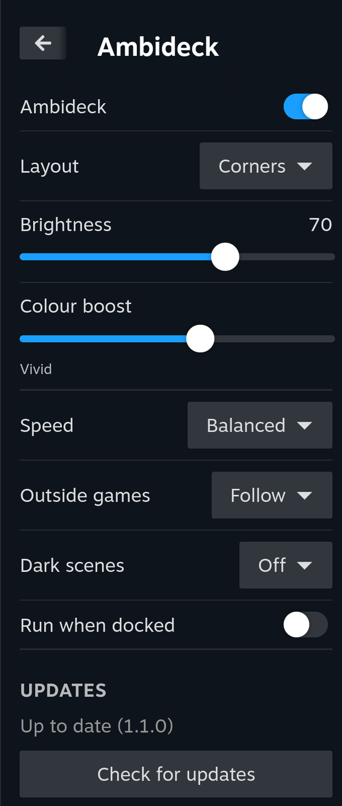
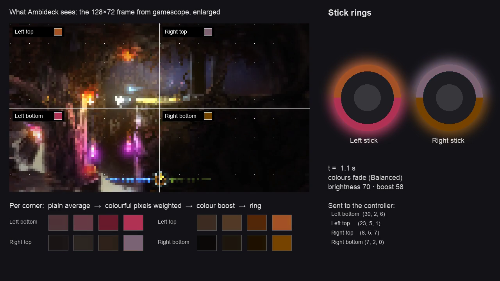

# Ambideck

A [Decky Loader](https://decky.xyz) plugin that turns the ROG Xbox Ally's stick lights into an Ambilight: while
you play, each half of each ring takes the colour of its corner of the screen.

https://github.com/user-attachments/assets/d378b852-994a-4eab-8c60-6a79b5997024

## What it does

- **Follows the screen** in any game: four corners (top and bottom half of each ring), or one colour per side.
- **Keeps colours alive:** colourful pixels count more than grey ones, and dim scenes are lifted, so pastel and
  dark scenes keep their tint.
- **Dark scenes:** a near-black corner leaves a faint glow, or switches its half of the ring off.
- **Hands the lights back** when you stop playing: to [HueSync](https://github.com/honjow/HueSync)'s setting if
  you use it, otherwise to the controller's rainbow.
- **Per game:** switch it off for games where it distracts.
- **Outside games:** off, your normal lights, or follow the screen just like in a game. Following outside games
  keeps the capture running whenever Game Mode is up: about 7 % of one CPU core and roughly 0.2 W.
- **Docked:** off by default; one switch to keep it on.
- **Light on resources:** gamescope hands over a tiny 128×72 frame; about 7 % of one CPU core in total.
- **Updates itself:** tells you when a new release is out and installs it through Decky.
- **Makes way for screen recorders:** while a recorder such as [Showreel](https://github.com/michpalm/showreel)
  holds the capture lock, Ambideck lets go of gamescope's screen stream and hands the lights back
  (see [Screen recorders](#screen-recorders)).

## Install

Ambideck is not in the Decky plugin store. In Game Mode:

1. Decky → Settings → General → turn on **Developer mode**.
2. Download `ambideck.zip` from the [latest release](../../releases/latest).
3. Decky → Settings → Developer → **Install plugin from ZIP**.

## Settings

Quick Access (…) → Ambideck: on/off, **In this game**, **Layout** (Corners or Sides), **Brightness**,
**Colour boost**, **Speed** (Smooth, Balanced, Fast), **Outside games** (Off, Normal colour, Follow),
**Dark scenes** (Glow, Off) and **Run when docked**.



## Updates

Once a day Ambideck asks GitHub for the latest release. When there is a newer one, Quick Access → Ambideck shows
**Update to X.Y.Z**: press **Update** and confirm in Decky's dialog. Decky checks the download against the
release's SHA-256 and keeps your settings. **Check for updates** asks right away.

## How it works



This is a real frame from the device, run through Ambideck's own colour code:

1. gamescope (Steam's compositor) shrinks every frame to 128×72 on the GPU and hands it over through PipeWire.
2. The frame is split into four corners, one per half ring, and every 4th pixel of each corner is read.
3. Colourful pixels are weighted more than grey ones, then the colour boost raises the saturation.
4. The ring's brightness follows the corner's brightness on a curve that lifts dim scenes, with a small minimum
   glow (or off, with Dark scenes = Off).
5. Colours fade smoothly between frames and jump on scene cuts, then go to the controller with the same HID
   message the kernel driver uses.

When Ambideck takes over, it asks HueSync to step aside; when it stops, it asks HueSync to re-apply your setting
for the current game and power state. Both go through HueSync's own backend, and no HueSync code is copied.

## Screen recorders

gamescope has a single screen stream, and the first app reading it sets its size for every reader. Ambideck asks
for a tiny frame, so a recorder that joins later would record at 128×72. Disconnecting a full-size reader while a game
is drawing can also crash gamescope on SteamOS 3.8.

So recorders can ask Ambideck to step aside: write `/run/decky-screen-capture.lock` as root, containing
`{"pid": <recorder pid>, "owner": "<name>"}`. Ambideck checks it every 0.5 s, and again right before every connection,
and stays off the stream while the lock exists and that process is alive (zombies count as dead). Remove the lock only
after your recorder has disconnected from gamescope. [Showreel](https://github.com/michpalm/showreel) does this.

## Compatibility

Tested on a ROG Xbox Ally (RC73YA) running Bazzite and SteamOS 3.8, handheld and docked to a TV. The original Ally and Ally X use
the same driver and should work, but their zone order is untested. Other handhelds are not supported: the panel
says so and Ambideck does nothing.

## Development

```bash
pnpm install
pnpm test
python3 -m venv .venv && .venv/bin/pip install pytest && .venv/bin/pytest tests/py
scripts/package.sh   # builds out/ambideck.zip
```

`scripts/serve.sh` serves the zip on your network for **Install plugin from URL**.
`scripts/demo-capture.py` and `scripts/demo-render.py` make the picture in How it works (and a video of it).
[docs/device-checklist.md](docs/device-checklist.md) lists what to check on the device.
Releases are tagged `vX.Y.Z` and carry the package as `ambideck.zip`; the updater relies on both.

## About this project

A personal project, maintained on a best-effort basis. The code was written with [Claude](https://claude.ai)
(Anthropic's AI), directed, reviewed and tested on device by the author.

## Support

Ambideck is free. If you'd like to support its development, you can do so on Ko-fi. It's entirely optional: bug
reports and ideas are just as welcome.

[](https://ko-fi.com/michpalm)

## Credits

- ROG Ally light protocol as documented by [HHD](https://github.com/hhd-dev/hhd) and the Linux `hid-asus-ally`
  driver (Luke D. Jones, Denis Benato).
- Works alongside [HueSync](https://github.com/honjow/HueSync) by honjow through its public backend methods.
- Demo footage: Ori and the Blind Forest: Definitive Edition by Moon Studios / Xbox Game Studios.
- Not affiliated with ASUS, Microsoft, Valve, Philips or any game shown.

## License

[MIT](LICENSE)
